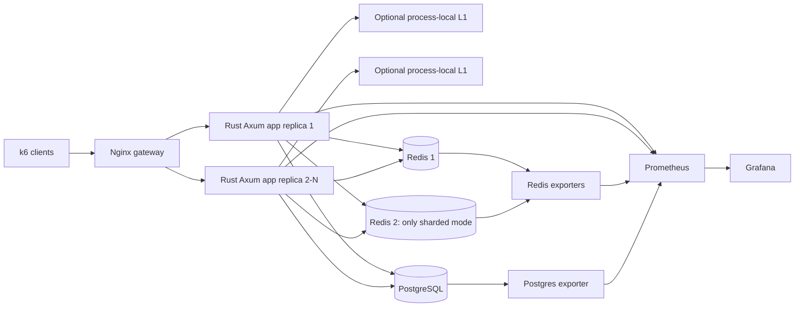

# Architecture and caching mechanisms — Rust version

## Business context

The order-processing system includes Order Placement, Inventory, Payment, Warehouse, Order Fulfillment, Shipping and Notification in its broader domain. The executable PoC implements only the **flash-sale product page (query projection)**, **activity updates**, and **transactional order placement/stock reservation**. It does not implement an event bus or simulate payment/shipping. The goal is to isolate caching mechanisms, not evaluate a complete microservice architecture.

`GET /products/1/snapshot` returns `id`, `name`, `category`, `price_cents`, `stock`, `revision`, `interactions`, `views`, `favorites`, `purchases`, `demand_score` (`views + 3*favorites + 5*purchases`). The dataset has 10,000 products, with 70% of default 250,000 historical activity rows concerning the hot product, `Flash Sale Laptop`. The indexed history is aggregated on each uncached request, giving a clear workload for comparing no cache versus shared Redis. In a real system, also consider incremental counters, materialized views, CQRS projections and precomputed statistics; a cache is not automatically the best design.

## Topology

- Rust handlers: `app/src/main.rs` (Axum, typed JSON, response headers)
- Rust query/transaction layer: `app/src/storage.rs` (SQLx pool, explicit SQL)
- Rust cache alternatives: `app/src/cache.rs` (async Redis connection manager, TTL, L1, two-way sharding, distributed single-flight)
- Metrics and environment parsing: `app/src/metrics.rs` and `config.rs`
- Orchestration: Python `poc` / `scripts/benchmark_campaign.py`; k6 scenario `benchmarks/load.js`

## Cache read path

`db`: query PostgreSQL every time. Other modes: consult Redis (or local L1 first), then load from PostgreSQL when missing or Redis is unavailable. The `X-Cache-Source` response header contains `db`, `cache`, `db_miss`, `cache_wait`, or `db_fallback`.

`POST /products/{id}/activity` increments the authoritative product revision and appends an activity event in one PostgreSQL transaction. Only after commit does the application invalidate or refresh Redis, depending on mode. Plain `aside` leaves the old snapshot until TTL. `write_through` is application-managed refresh after commit, **not atomic write-through persistence**. In `l1l2`, only the writer's process-local cache is cleared; another replica may serve stale data until its L1 TTL expires.

`POST /orders` uses `UPDATE products SET stock=stock-$2, revision=revision+1 WHERE id=$1 AND stock >= $2 RETURNING ...` inside the same transaction as `INSERT INTO orders` and purchase history. The response is 409 on insufficient inventory. **Cached availability never controls stock reservation.** Snapshot stock may lag the DB and must be labeled display-only.

## Protected mode

- On miss, attempt `SET lock:snapshot:<key> <token> NX PX 10000`.
- Winner double-checks the cache, computes and stores the snapshot, and releases the lock with token-checked Lua.
- Other requests poll cache up to ~1.9 seconds and return the computed value if it appears.
- On lock timeout or Redis failure, the DB fallback preserves best-effort availability rather than guaranteeing only one DB read.

Limitations: 10-second lock TTL is fixed; a slow leader can outlive its lock, lock ownership is not fenced for DB writes, Redis outages defeat coalescing, and race conditions can reintroduce stale values. This is experimental coordination, not a production-ready distributed lock manager.

## Sharding and L1

`sharded` calculates `CRC32(cache_key) % 2`. Each Redis instance stores its half of the keyspace. This is application-managed partitioning with **no replication or failover**; it is neither Redis Cluster nor consistent hashing. `l1l2` uses process-local entries with per-entry expiration, limited to 10,000 entries, plus Redis as L2. It is designed to expose the trade-off between latency and cross-instance freshness.

## Observability

Prometheus scrapes `/metrics` from each Rust replica via Docker DNS and scrapes Redis/PostgreSQL exporter metrics. Grafana dashboards and the k6 campaign compare HTTP latency, observed throughput, failures, hit/miss ratio, fallback counts and database work. No OpenTelemetry/Tempo/Loki services are necessary for this cache-focused laboratory.

## Architectural caveats

In the face of concurrent reads/writes, neither an after-commit invalidation nor a subsequent cache SET guarantees immediate consistency. DB commit may succeed while Redis is down. E17 tests *sequential* revision freshness; it does not establish linearizability. E13 uses an artificial application-side database read delay. Compare cache against database alternatives (materialized view, incremental aggregation, read replicas) as a possible follow-on PoC.
